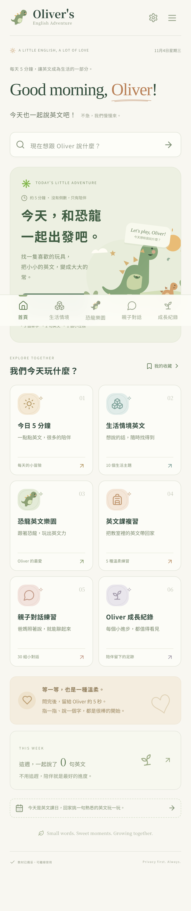

# Oliver's English Adventure

**Oliver 的英文小冒險** · 每天 5 分鐘，讓英文成為生活的一部分。

給 3–5 歲孩子與爸媽的親子英文 PWA。爸媽拿手機查句子、聽示範，孩子在真實生活中和爸媽互動。沒有考試、倒數、排名、登入、廣告或付費服務。



## 快速啟動

建議使用 **Node.js 24 LTS**（`.nvmrc`）；最低版本 22.12。npm 使用已提交的 `package-lock.json`。

```sh
cd /workspace/Oliver-Englisg
npm ci
npm run dev
```

開發服務使用 5173 埠。雲端環境若有埠預覽介面，可選擇 5173。開發模式不註冊 Service Worker，避免舊快取影響程式修改。

驗證真正的離線模式，使用另一個埠啟動正式建置：

```sh
npm run build
npm run preview -- --port 4173 --strictPort
```

PWA 需要 HTTPS；本機開發的 loopback 位址是瀏覽器特例。iPhone 連到電腦的普通 HTTP 區網 IP，不等同 HTTPS，請用正式 HTTPS 網址驗收安裝與離線。

不需要 `.env`、帳號、API key、後端或資料庫。所有字型使用系統字型，沒有 CDN 依賴。

## 已實作的使用流程

- **首頁六個入口**：今日 5 分鐘、生活情境、恐龍樂園、英文課複習、親子對話、成長紀錄。常用教材有收藏小口袋。
- **每日推薦**：3 個單字、2 句生活英文、1 組對話、1 個動作任務。依裝置的當地日期、難度、最近練習、輪替主題、恐龍偏好、上課日挑選。每天的組合會保存，記錄程度或重新開啟不會偷偷換題；可「換一組」或「今天先休息」。
- **熟悉與挑戰**：有足夠熟悉教材時，7 個項目優先安排約 5 個熟悉項目、2 個新項目。剛開始沒有觀察資料時，不假裝孩子已學會，先依目前程度探索。Level 2 為初始設定，兼顧 Level 1 與少量 Level 3。
- **10 個生活情境**：早晨、清潔、飲食、穿衣出門、玩具恐龍、戶外、收拾、情緒禮貌、朋友分享、睡前。支援類型與程度篩選。
- **中英文教材搜尋**：可搜尋「快去刷牙」、「不要丟玩具」、「你想吃什麼」、「把恐龍放回盒子」與 `Are you hungry?`。沒有收錄時明確提示，不產生假的即時翻譯。
- **5 種英文課複習**：聽懂指令、選擇與回答、完整句子、主動需求、生活遷移。包含顏色、動物、字母、車子、磁鐵、收銀機、硬幣、椅子、圍欄、分類、大小與位置。`cash register` 是收銀機。
- **親子對話**：逐句或整段顯示、自由跳句、上一句／下一句、中文切換、逐句語音與慢速播放；每句可獨立收藏及記錄程度。
- **語音**：Web Speech API，優先 en-US；可選裝置提供的英文語音。每次播放先取消前一句，提供停止按鈕，切頁或進入背景時停止。沒有英文語音時提供下載建議，無自動播放或麥克風權限。
- **成長紀錄**：尚未學習、聽得懂、提示後會說、能主動說出，四種互斥狀態。記錄最近日期、練習次數、各主題進度。週一至今天的摘要依教材句子 ID 去重，重播／重複觀察不會重複增加同週句子數；單字、任務與對話標題不混入句子總數。對話各場景台詞有獨立 ID。
- **JSON 備份**：匯出後可存入「檔案」App；匯入先驗證版本、資料型別、教材 ID、日期及大小，再預覽並由家長確認取代。錯誤檔案或取消不改現有資料。上限 2 MB。
- **PWA**：Manifest、192／512 PNG、maskable icon、Apple touch icon、standalone、安全區域、完整內建教材的離線快取。離線仍能看教材、收藏、保存程度與備份。
- **個人設定**：暱稱、三個難度、上課星期（預設三、五）、英文聲音、安裝指引。沒有連續打卡壓力。

## 內建教材

所有內容在 `src/data/` 中，以 TypeScript 結構化保存，無 Lorem Ipsum、生成占位或外部載入。

| 類型     | 數量 | 內容                                          |
| -------- | ---: | --------------------------------------------- |
| 英文單字 |  126 | 10 個生活主題，含恐龍、玩具、動物與顏色       |
| 英文句子 |  112 | 100 句生活英文＋12 句銜接課堂的指令與需求表達 |
| 親子對話 |   30 | 每組 6 句、3 個來回；合計 180 句具角色的台詞  |
| 動作任務 |   20 | 每主題 2 個真實生活活動，附道具與操作說明     |

各筆包含 `id`、`category`、`difficulty`、`english`、`traditionalChinese`、`parentTip`、`suggestedReply`、`tags`。句子有 `nextLine`；對話有帶角色與中英台詞的 `turns`；動作有 `materials` 與 `instruction`。

英文已在編寫時檢查自然用法與語法，例如食物選擇用 `What would you like to eat?`、分類用 `same or different`。自動測試驗證數量、欄位、唯一 ID 與分類覆蓋；自動測試不能取代真人教師審稿，未聲稱有外部專業審查。

爸媽提示鼓勵等待約 5 秒、接受手勢與單字、不強迫完整句。磁鐵與硬幣活動使用大型安全玩具及玩具代幣替代，由成人陪同。

## 專案結構

```text
src/
  App.tsx                 Hash 導覽、桌面側欄、手機底列、全域提示
  main.tsx                React 入口
  styles.css              奶油白／鼠尾草綠的響應式繪本介面
  types.ts                教材、觀察、設定與備份型別
  components/
    Art.tsx               自製恐龍與花園 SVG、圖示
    Cards.tsx             教材、發音、收藏、程度與任務卡
  data/
    categories.ts         10 個分類與爸媽提示
    words.ts              126 個單字
    sentences.ts          112 句英文
    dialogues.ts          30 組對話
    tasks.ts              20 個動作任務
    review.ts             5 種課堂複習模式
    index.ts              資料索引、可記錄的對話台詞
  lib/
    context.tsx           App 狀態與語音生命週期
    storage.ts            本機存取、備份驗證、週摘要
    recommendations.ts    每日推薦與雙語搜尋
    dates.ts              裝置當地日期與週界線
    speech.ts             語音篩選與選擇
    pwa.ts                SW 註冊、快取狀態、更新提示
  pages/                  首頁、教材、對話、搜尋、紀錄與設定
public/
  manifest.webmanifest
  icon.svg                原創恐龍圖示來源
  *icon*.png              實際 PNG 圖示（不是改副檔名的 SVG）
  _headers                Netlify／Cloudflare Pages 的靜態標頭設定
scripts/
  build-sw.mjs            由完整 build 雜湊產生離線快取清單
  generate-icons.mjs      從原創 SVG 產生 PNG
  capture.mjs             實際頁面截圖
tests/
  unit.test.ts            教材、搜尋、推薦、備份與計數測試
  app.e2e.ts              行動介面與離線操作測試
  update.e2e.ts           新版 SW 等待確認、資料保留與舊快取清除
.github/workflows/
  ci.yml                  TypeScript、單元測試、Build、Chromium E2E
  deploy-pages.yml        維護者手動執行的 GitHub Pages 部署
```

## 驗證

```sh
npm run typecheck
npm test
npm run build
npx playwright install --with-deps chromium  # 開發機首次需要；已有 Chromium 可略過
npm run test:e2e
```

有系統 `/usr/bin/chromium` 時自動使用；也可設定非機密的 `PLAYWRIGHT_CHROMIUM_EXECUTABLE` 路徑。未指定則使用 Playwright 安裝的 Chromium。雲端的限制模式可能需要執行工具核准啟動瀏覽器與本機服務。

`npm run test:e2e` 會自動啟動 4173 的 **正式建置預覽**，所以先執行 Build。開發時可重用同埠既有預覽服務；CI 會啟動自己的服務。測試產物在忽略的 `test-results/`，失敗時有 trace。

驗證紀錄及 iPhone 真機待測清單見 [docs/TESTING.md](docs/TESTING.md)。手機測試使用 Chromium 的 iPhone 13 尺寸模擬，**不等於 iPhone Safari 或主畫面 PWA 真機測試**。

## 正式部署

這是純靜態網站，只需要把 `dist/` 部署到支援 HTTPS 的靜態主機。資料不會傳到主機。

### GitHub Pages（附手動工作流程）

1. 將本專案程式碼提交到 `azin0609-dev/Oliver-Englisg`。
2. Repository 的 **Settings → Pages → Build and deployment → Source** 選 **GitHub Actions**。
3. 到 **Actions → Deploy to GitHub Pages → Run workflow**，選擇 `main` 執行。
4. 工作流程成功後使用 GitHub 回報的正式 HTTPS 網址；預期專案路徑是 `https://azin0609-dev.github.io/Oliver-Englisg/`，此網址僅是部署後的預期位置，尚未在本任務中發布或驗證。
5. 用 Safari 開啟，等待 App 顯示快取已備妥，再做離線與安裝驗收。

`base: './'`、相對 Manifest／圖示路徑、SW scope 與 Hash 路由可支援子目錄。不要只上傳 `index.html`，要上傳完整 `dist/`。不需要 SPA 的伺服器路由重寫。

GitHub Pages 免費方案的私有儲存庫權限依 GitHub 方案而定；若該儲存庫無法開 Pages，可用下列靜態主機。不會自動觸發正式發布；只有維護者手動啟動部署流程才部署。

### Cloudflare Pages 或 Netlify

- 使用 Node.js 24。
- 安裝：`npm ci`。
- Build command：`npm run build`。
- Publish/output directory：`dist`。
- 不需環境變數或 Secret。
- 選擇 HTTPS 網域；可先用主機提供的免費子網域。
- `public/_headers` 會一起輸出，支援的主機會套用不允許麥克風／相機／定位的權限政策及快取標頭。GitHub Pages 不讀取 `_headers`，但本 App 本來就不呼叫這些裝置權限。

若主機另有 CDN 規則，請讓 `sw.js`、HTML 與 Manifest **重新驗證、不長期快取**；只有具內容雜湊的 `assets/*` 可以 immutable 長快取。

### 新版與離線快取

Build 會雜湊所有可快取的 App 資源（排除主機使用的 `_headers` 設定檔），產生版本化 SW cache，安裝時先完整快取。頁面與程式資源維持同一版，不會把新版 HTML 配上舊版 JavaScript。新版下載完成後顯示「更新 App」，爸媽點擊才切換並重新載入；重新開啟或回到前景時會檢查更新。啟用新版後清除 App 的舊 shell cache，**不清除 localStorage 學習紀錄**。

不要把同源其他 App 的資料放進本 App 快取。更新前匯出備份是良好習慣；若未連網，新版要等下一次連網才能下載。

## iPhone 加入主畫面

1. 在 **Safari** 開啟正式 HTTPS 網址，第一次保持連網。
2. 點 **分享**，向下找到 **加入主畫面**。
3. 如果有「以 Web App 開啟」，保持開啟，再點 **加入**。
4. 回到主畫面，點恐龍圖示啟動；應是獨立畫面，無 Safari 網址列。
5. 先確認快取完成，再開飛航模式測試情境教材、收藏與紀錄。
6. 若要離線發音，先到 iPhone **設定 → 輔助使用 → 朗讀內容／閱讀與朗讀 → 聲音 → 英文** 下載裝置語音（名稱依 iOS 版本不同）。在 App 設定選英文語音並點試聽。

發音一定由家長點擊觸發。聲音品質、可選語音與離線發音依裝置而異；本任務沒有真機證據，不能保證每台 iPhone 有相同語音。Safari 與加入主畫面的 App，資料空間可能依 iOS 版本而不同；切換使用前先匯出，必要時在另一個容器匯入。

## 隱私與備份

- 只使用 localStorage，key 為 `oliver-adventure-v1`。Cache Storage 只保存 App 與公開內建教材。
- 無帳號、雲端同步、分析 SDK、第三方廣告、錄音、定位或麥克風功能。
- 只需顯示暱稱，不要求完整姓名或生日。
- App 不上傳學習紀錄。系統語音由瀏覽器／作業系統供應商提供；部分聲音可能需要網路，設定中標示「裝置語音」的聲音更適合離線使用。
- 本機資料受裝置與瀏覽器儲存政策影響，清除網站資料、移除 App 或裝置空間不足可能遺失。儲存失敗會明確提示，仍可匯出當前記憶體中的資料。
- 匯入為**取代**，不是自動合併。兩支手機之間可手動傳送 JSON，但沒有衝突處理或跨裝置同步。
- 備份含暱稱與練習觀察，應由家長自行保管。

## 目前限制與後續升級

已完成第一版程式與桌面 Chromium／行動尺寸自動化驗證；尚未實際部署，也未在 iPhone Safari、實體主畫面模式或不同 iOS 系統聲音上真機驗收。不能將模擬測試視為這些項目已通過。

未實作登入、雲端資料庫、AI 翻譯、兒童語音辨識、推播、付款或跨裝置同步；這些皆不在第一版範圍。

後續可先做真機與家長可用性測試、請幼教英文教師審稿，再增加家長自訂句子與課堂筆記。若未來增加同步，應先在資料儲存層加入明確的家長同意、權限與版本衝突策略；不要直接把既有兒童學習紀錄上傳。原創恐龍、花園 SVG 與 App Icons 隨原始碼提供；Lucide 圖示依其 ISC 授權，React／Vite 等依各套件授權。
